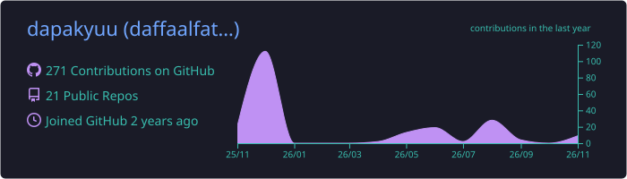
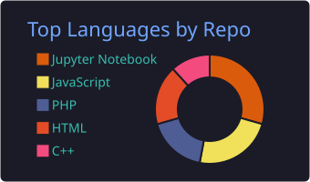
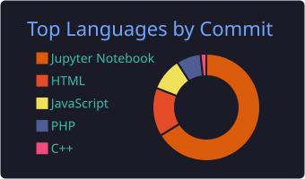
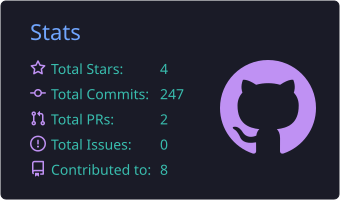
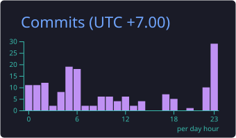

<!-- Header -->

  

  

  
  
  
  

---

## 🧑‍🚀 About me

I'm a **Computer Engineering undergraduate** at **Universitas Pendidikan Indonesia (UPI) Kampus Cibiru** who loves building things for the web and teaching machines to learn, from the first idea all the way to a product people actually use.

- 🎓 Computer Engineering @ UPI Kampus Cibiru · **GPA 3.95**
- 🏆 **Best Capstone Project** at ASAH by Dicoding (Machine Learning track)
- 💼 Ex-**Laravel Web Developer intern** @ PT. Winnicode Garuda Teknologi
- 📄 Projects published as scientific articles, incl. **Jurnal Tekno Kompak** (Vol. 19, No. 1, 2025)
- 🌐 **MikroTik Certified Network Associate** (MTCNA)
- 🗣️ Bahasa Indonesia · English · 日本語
- 🤝 **Open to job opportunities & collaborations**

 

## 🛠️ Tech stack

<table align="center">
  <tr>
    <td align="center" width="140"><b>🌐 Web</b></td>
    <td></td>
  </tr>
  <tr>
    <td align="center"><b>🧠 ML & Data</b></td>
    <td></td>
  </tr>
  <tr>
    <td align="center"><b>🗄️ Database</b></td>
    <td></td>
  </tr>
  <tr>
    <td align="center"><b>📱 Mobile & Game</b></td>
    <td></td>
  </tr>
  <tr>
    <td align="center"><b>🔧 Tools</b></td>
    <td></td>
  </tr>
</table>

## 📊 GitHub stats

<!-- Kartu di bawah dibuat otomatis oleh .github/workflows/profile-summary-cards.yml -->

  

  
  

  
  

  

## ✨ Featured projects

<table>
  <tr>
    <td width="50%" valign="top">
      
      <h3>🔍 Forensa</h3>
      
AI-powered verification of educational PDF documents, built from a UPI lecturer's research.

      

        
        
        
      

      <a href="https://github.com/dapakyuu/DigitalForensik">Repo</a> · <a href="https://forensa.tech/">Live demo</a>
    </td>
    <td width="50%" valign="top">
      
      <h3>🎙️ AI Interview Assessment</h3>
      
Assesses candidates through AI interviews using LLMs and multimodal (audio + visual) analysis.

      

        
        
        
      

      <a href="https://github.com/dapakyuu/Interview_Assesment_System">Repo</a> · <a href="https://interview-assesment-system.vercel.app/">Live demo</a> · <a href="https://interview-assesment-system-docs.vercel.app/">Docs</a>
    </td>
  </tr>
  <tr>
    <td width="50%" valign="top">
      
      <h3>📰 Winnicode News Portal</h3>
      
Laravel news portal integrating NewsAPI, BMKG weather, and live football scores.

      

        
        
      

      <a href="https://github.com/dapakyuu/WinnicodePortalBerita">Repo</a> · <a href="https://winnicode.forensa.tech/">Live demo</a>
    </td>
    <td width="50%" valign="top">
      
      <h3>🔔 HoloBell</h3>
      
Hololive streaming schedule website powered by the Holodex API.

      

        
        
      

      <a href="https://github.com/dapakyuu/HoloBell">Repo</a>
    </td>
  </tr>
  <tr>
    <td width="50%" valign="top">
      
      <h3>📚 MangaDex Read Status Filter</h3>
      
Userscript that adds read-status filters to MangaDex Advanced Search.

      

        
        
      

      <a href="https://github.com/dapakyuu/mangadex_readstatus_filter">Repo</a> · <a href="https://greasyfork.org/en/scripts/559036-mangadex-read-status-filter-for-advanced-search">Install</a>
    </td>
    <td width="50%" valign="top">
      
      <h3>🎮 RPG Game (Godot)</h3>
      
RPG with data-structure mini games: stack, queue, and sort.

      

        
        
      

      <a href="https://github.com/dapakyuu/RPG-Game_Godot">Repo</a>
    </td>
  </tr>
</table>

  

## 🐍 Contribution snake

<!-- Dibuat otomatis oleh .github/workflows/snake.yml -->

  <picture>
    <source media="(prefers-color-scheme: dark)" srcset="https://raw.githubusercontent.com/dapakyuu/dapakyuu/output/github-snake-dark.svg" />
    <source media="(prefers-color-scheme: light)" srcset="https://raw.githubusercontent.com/dapakyuu/dapakyuu/output/github-snake.svg" />
    
  </picture>

## 📫 Let's connect

  Got a project idea, a job offer, or just want to say hi? 
  Reach me on <a href="https://www.linkedin.com/in/daffa-al-fathir-ismail/"><b>LinkedIn</b></a> or through the contact form on my <a href="https://daffa.forensa.tech/#contact"><b>portfolio</b></a>.

<!-- Footer -->

  

